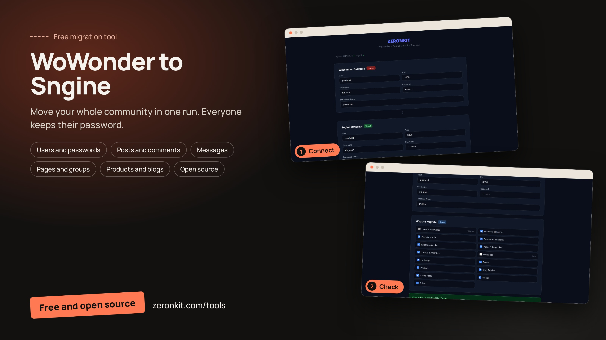
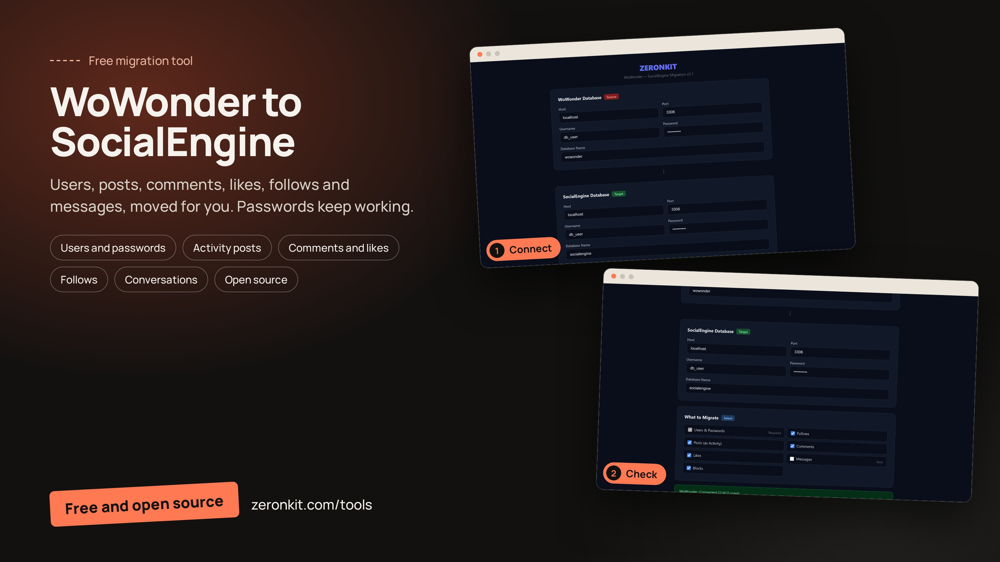
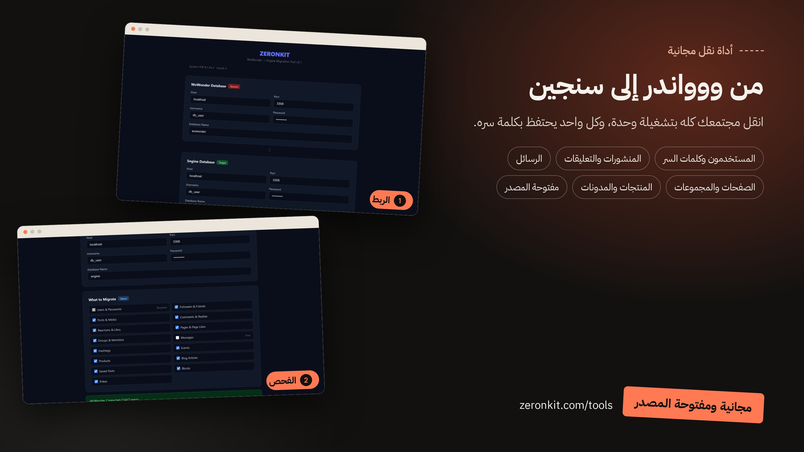
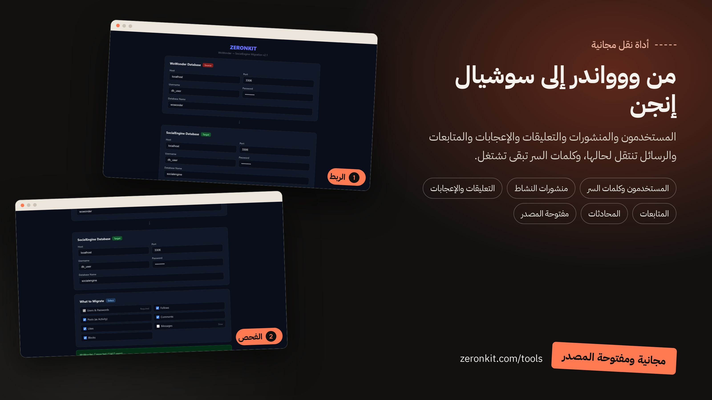

# ZeronKit Migration Tools

<table><tr>
<td width="50%"></td>
<td width="50%"></td>
</tr><tr>
<td width="50%"></td>
<td width="50%"></td>
</tr></table>

Free, open source tools that move a whole WoWonder social network to another platform. Each tool is one PHP file that runs on your own server: no licence key, no account, no internet connection, and your database details never leave your server.

| Tool | Moves | Target |
|---|---|---|
| [wowonder-to-sngine.php](wowonder-to-sngine.php) | Users, posts, comments, reactions, followers, friends, pages, groups, messages, hashtags, events, products, blogs, pokes, blocks | Sngine 4.x |
| [wowonder-to-socialengine.php](wowonder-to-socialengine.php) | Users, posts (as activity items), comments, likes, follows, messages (as conversations), blocks | SocialEngine 6.x |

Users keep their existing passwords: both targets accept WoWonder's bcrypt hashes, so nobody has to reset anything.

## How to use

1. **Back up** both databases and your files.
2. Install the target platform first (Sngine 4.x or SocialEngine 6.x), ideally fresh.
3. Upload the tool to your server's root folder and open it in your browser, for example `https://yourdomain.com/wowonder-to-sngine.php`.
4. Enter both database connections, press **Test Connection**, choose what to move and press **Start Migration**.
5. Copy the media files, check a few accounts, and **delete the tool from your server**.

Full step by step guides:
- [WoWonder to Sngine guide](https://zeronkit.com/wowonder-to-sngine/)
- [WoWonder to SocialEngine guide](https://zeronkit.com/wowonder-to-socialengine/)

Requires PHP 7.4 or newer (PHP 8.x works) with the mysqli extension and access to both databases.

## Good to know

- **Your admin account stays as it is.** The admin you made when installing the target keeps user id 1, its username, email and password. WoWonder's own user 1 is moved to the first free id after your last WoWonder user, together with all of its posts, comments, messages and follows. If WoWonder user 1 has the same username or email as your admin, it is treated as the same person: no second account is made and its content goes to your admin. The progress screen says which of the two happened.
- **Running it again is safe.** Each step clears what it moved last time before it moves it again, so nothing is doubled.
- **Errors do not stop the run.** If one row cannot be written (for example two WoWonder users share an email), the tool shows the database error, skips that row and carries on. A wrong database login stops the run straight away with a clear message, before anything is changed.
- **The numbers at the end are real.** They count the rows actually written, not the rows tried.
- **Dates come from WoWonder.** Join dates, post, comment, message, product, blog and follow dates are kept. Only where WoWonder has no date (for example reactions, or a date of 0) is the time of the migration used.

## Changelog

**2.1**
- WoWonder user 1 no longer takes over the target admin account. It is migrated as a normal user, or merged into the admin when it is the same person, with a notice.
- Dates are taken from WoWonder wherever it has them (last seen in Sngine, conversation dates in SocialEngine).
- End of run numbers show rows really written.
- Works on PHP 8.1 and newer without fatal errors: a wrong login gives a clear message, a failing row is shown and skipped.
- Products and blog articles are cleared before they are moved again, so a rerun does not duplicate them.
- Empty values (such as video views) no longer break the posts step.
- Users are always migrated (the option cannot be switched off), and the SocialEngine tool now checks that all required fields are filled in.

**2.0**
- First open source release: one self-contained file per tool, no licence key, no network calls.

## Licence

GNU General Public License v2 or later. Copyright ZeronKit. Provided as is, without warranty: always keep backups.

Website: [zeronkit.com](https://zeronkit.com) | All tools: [zeronkit.com/tools](https://zeronkit.com/tools/)
